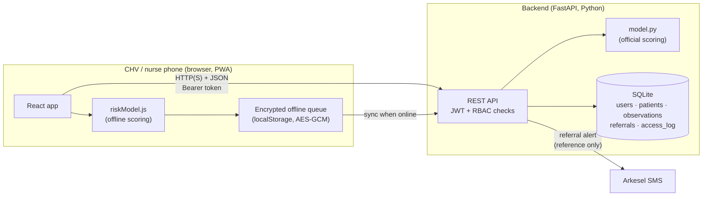
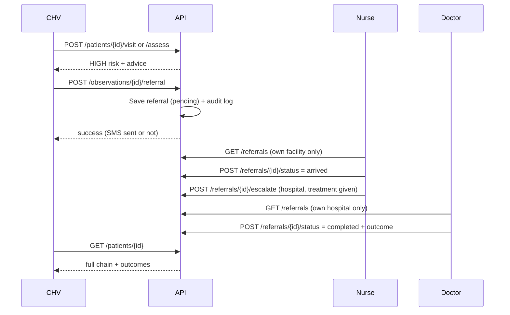

# HealthConnect Ghana

**A cloud platform that connects rural patients and Community Health Volunteers (CHVs) with health facilities, specialists and the Ghana Health Service (GHS).**

ICS 534 Cloud Computing · PROSIT 2 · Group 2, **Storm Surfers**
Instructor: Prof. Robert A. Sowah

> ⚠️ **Prototype, test data only.** This repository is public. Every patient, user and phone number in it is fake. HealthConnect is **not** connected to any real GHS, NHIS or DHIMS2 system.

---

## Contents

1. [The problem](#1-the-problem)
2. [Team](#2-team)
3. [Where we are now](#3-where-we-are-now)
4. [What the app does today](#4-what-the-app-does-today)
5. [User roles (RBAC)](#5-user-roles-rbac)
6. [Architecture](#6-architecture)
7. [Security and data protection](#7-security-and-data-protection)
8. [Running it locally](#8-running-it-locally)
9. [Trying it out (demo walkthrough)](#9-trying-it-out-demo-walkthrough)
10. [API reference](#10-api-reference)
11. [Project structure](#11-project-structure)
12. [Roadmap: the steps we will follow](#12-roadmap-the-steps-we-will-follow)
13. [Built vs simulated (honest status)](#13-built-vs-simulated-honest-status)
14. [Known limitations](#14-known-limitations)
15. [Prior work](#15-prior-work)
16. [Contributing](#16-contributing)

---

## 1. The problem

In rural Ghana, a pregnant woman may live hours from the nearest facility. The first health worker she sees is often a **Community Health Volunteer (CHV)**. CHVs work on low-cost phones, often with weak or no mobile signal, and today their records are mostly on paper. When a CHV spots danger signs (for example very high blood pressure), there is no reliable way to tell the facility the patient is coming, and no way for the CHV to learn what happened next.

HealthConnect Ghana aims to give CHVs, facilities, specialists and GHS one connected system, built in four parts (one per PROSIT week):

| Week | Theme | Goal |
|---|---|---|
| 1 | Health records | Offline-first CHV app, vitals, multi-language, security (encryption, RBAC, audit log) |
| 2 | Telemedicine | Low-bandwidth video, appointments, prescriptions, referral prioritisation |
| 3 | Surveillance | Outbreak dashboard, maps, ML prediction, DHIMS2 integration (described) |
| 4 | Sustainability | Insurance / mobile money, traditional medicine, community ownership, revenue model |

---

## 2. Team

| Member | Role |
|---|---|
| Alice Iris Kare Acquah | Cloud / Infrastructure Lead |
| Henry Kofi Brandoh | Application / PWA Lead |
| Clifford Yeboah | Data Lead |
| Isaac Ansah Amoah | Community & Documentation Lead |

### Who is working on what

| Workstream | Who | Roadmap phase |
|---|---|---|
| Cloud migration (AWS) | **Alice** | Phase 3 |
| App development (Week 2 and Week 3 features, hardening) | **Henry and Clifford** | Phases 2, 4, 5 |
| Language translation APIs (Twi and other Ghanaian languages) | **Isaac** | Phase 6 |
| Sustainability (Week 4) | **Whole team** | Phase 7 |

---

## 3. Where we are now

**Week 1 (health records) is done, and Week 2 has started: the facility referral inbox is built. HealthConnect now covers general visits for any patient, not just antenatal care.**

| Area | Status |
|---|---|
| Real login (username + password) | ✅ Done |
| Role-based access control (RBAC) | ✅ Done for CHV, nurse, doctor and GHS officer; admin sees a "coming soon" screen |
| Patient registration with consent | ✅ Done |
| General visit for any patient (symptoms, vitals, triage, possible conditions) | ✅ Done |
| Antenatal risk check (pregnant patients) | ✅ Done |
| Risk check works **offline** | ✅ Done |
| Offline data **encrypted** on the phone | ✅ Done |
| Audit log of every access | ✅ Done |
| Referral to facility (record + SMS) | ✅ Done |
| Nurse referral inbox + outcomes | ✅ Done |
| Nurse escalation to a hospital doctor + doctor inbox | ✅ Done |
| Patient history for nurses/doctors (referred patients only) | ✅ Done |
| Appointments + SMS confirmation and 24h reminder | ✅ Done |
| CHV can refer MEDIUM cases with a reason | ✅ Done |
| Inbox prioritised by risk, danger signs and waiting time | ✅ Done |
| English + Twi | 🟡 English complete; Twi partial (needs review by a Twi speaker) |
| Cloud deployment (AWS eu-north-1) | ⬜ Not started (runs locally for now) |
| Video consults (CHV, nurse, doctor) with audio-only mode | ✅ Done (local; TURN relay not built) |
| GHS surveillance dashboard (anonymised, alerts, trends, map) | ✅ Done |
| ML model evaluation | ✅ Done: decision **not** to use XGBoost yet |
| DHIMS2 export (DHIS2 format, simulated) | ✅ Done (not sent to DHIMS2) |
| Admin account management | ⬜ Planned |
| Sustainability model | ⬜ Week 4 (report) |

All of this work is on the **`main`** branch.

---

## 4. What the app does today

### For a CHV
- **Sign in** with a personal account.
- **See "My patients"** with counts of high, medium and low risk, and search by name or reference.
- **Register any patient** (any age, female or male), but only after ticking that the patient has given consent (Data Protection Act, 2012).
  Each patient gets a random reference such as `HC-1D28D0`. Female patients aged 10+ can be marked **pregnant**.
  An optional **phone number** can be added, used **only** for appointment reminders.
- **Record a general visit** for anyone: a symptom checklist (fever, cough, diarrhoea, stiff neck, convulsions…) plus optional temperature, BP and pulse.
  The app gives a triage level and lists **possible conditions to test for** (malaria, cholera, meningitis, measles, pneumonia, hypertension).
- **Record an antenatal check** for pregnant patients: gestational age, blood pressure, weight, haemoglobin, temperature, heart rate, previous complications.
- **Get a risk level** (LOW / MEDIUM / HIGH) with advice for either check, **even with no signal**.
  Offline checks are encrypted, saved on the phone, and synced automatically when signal returns.
- **Refer a HIGH-risk patient** to the facility. This creates a referral record and sends an SMS that contains the reference, **not the patient's name**.
- **Refer a MEDIUM-risk patient** if worried, but a **reason is required** (e.g. "fever not improving after 2 days"). LOW cannot be referred.
- **See upcoming appointments** on the patient page, with a warning when the patient has no phone so the CHV can remind them in person.
- **Follow the whole chain**: health centre (waiting → arrived → completed), and, if the nurse referred onward, the hospital step and the doctor's outcome.

### Who starts a referral?

| Step | Who | To where | Rule |
|---|---|---|---|
| 1 | **CHV** | Their own health centre | HIGH: always. MEDIUM: only with a reason. LOW: never |
| 2 | **Nurse** | A hospital with a doctor | **Always** (team rule: every patient is seen by a doctor). Only after the patient has **arrived**; the nurse records the treatment given. The first referral closes with "Referred on to …" |
| 3 | **Doctor** | – | Records the final outcome. **Only doctors can close a case** |

This follows Ghana's referral tiers: community (CHV / CHPS) → health centre → district hospital.

> **Design decision and trade-off:** the team chose that **every** referred patient must be reviewed by a doctor, so the doctor always knows the final outcome. The server enforces it (a nurse trying to close a case gets 403). The cost is doctor workload: in real Ghanaian health centres, nurses and physician assistants resolve many cases alone, so a real deployment might limit mandatory doctor review to urgent cases.

### For a facility nurse / midwife
- **Referral inbox** for their own facility only, with tabs for Waiting / Arrived / Completed, **sorted by priority** (see below).
- See whether it is a general or antenatal visit, the readings and symptoms that triggered it, the possible conditions (e.g. meningitis, so they can prepare), and which CHV sent it.
- **Mark as arrived**, give treatment, then **Refer to doctor** (choose a hospital, record the treatment given and what the doctor should check). Nurses cannot close a case themselves.

### How the inbox is prioritised (`backend/priority.py`)

| Factor | Points |
|---|---|
| Risk HIGH / MEDIUM | +50 / +20 |
| Any danger sign (danger-sign symptom, BP ≥ 160/110, or Hb < 7) | +30 |
| Waiting time while not completed | +1 per 10 min, **capped at +30** |

**≥ 80 = Urgent, ≥ 50 = High, otherwise Routine.** Ties: whoever has waited longest first.
The cap means a long-waiting MEDIUM case can catch up with a plain HIGH case, but never overtake a HIGH case with danger signs. Each card shows its badge, danger signs and waiting time, so staff can see why it is where it is.

### Appointments and SMS reminders (`backend/reminders.py`)
- A nurse or doctor books a follow-up from a referral card, so **only for patients referred to their facility** (need-to-know).
- If the patient has a phone: a **confirmation SMS** at booking, and a **reminder ~24 hours before**. Each reminder is tried **once** (no spamming).
- Booked for **less than a day away**? The confirmation counts as the reminder, so the patient gets one SMS, not two.
- Appointments whose time has passed but are still "booked" are **highlighted in red** so staff mark them Attended or Missed.
- SMS text has **no name and no diagnosis** (shared phones): *"HealthConnect: Reminder: you have an appointment at Test Health Centre on Sun 01 Nov, 08:11. Ref HC-XXXXXX."*
- No phone: the CHV sees the appointment on the patient page and reminds in person.
- The reminder job runs **every 10 minutes inside the API** (FastAPI lifespan task). In the cloud this becomes an **EventBridge Scheduler rule calling a Lambda function**.
- Ghana uses GMT all year, so local time = UTC (no time-zone conversion needed).

### Video consults (`backend/calls.py`, `frontend/src/VideoCall.jsx`)
**Why:** the patient may be hours from the hospital. A live call lets the doctor (or nurse) see and hear the patient and decide "treat there" or "send now", so fewer sick patients travel and doctors can review many cases remotely.

- **Who:** anyone on the same referral chain: the patient's **CHV**, the **nurse** at the health centre, the **doctor** at the hospital. Calls are **1-to-1**; a third person sees "Call busy".
- **Start:** tap **📹 Video call** on the referral (inbox card or CHV visit history). The other side gets a banner: *"📞 Test CHV One is calling about Yaw: Join call"*.
- **Low bandwidth:** 320×240 video at 15 fps, capped at ~150 kbps, plus an **Audio only** button for very weak signal.
- **How it works:** **WebRTC** sends video **directly between the two browsers**. Our server is only the *introducer* (**signalling**): it passes the setup messages (offer, answer, network addresses) and nothing else. A public **STUN** server helps each side find its public address.
- **Limits (honest):** no **TURN** relay, so some strict mobile networks may fail to connect; call rooms live in server memory (one server only; in the cloud use Redis or API Gateway WebSockets); real phones need **HTTPS** for camera access (comes with the cloud deployment). Calls are not recorded.

### For a GHS officer: surveillance dashboard (`backend/surveillance.py`, `frontend/src/GhsApp.jsx`)
**Why:** spot outbreaks within days. Every general visit records possible conditions (malaria, cholera, meningitis…); counted by district and week, they show unusual rises early (**syndromic surveillance**).

- **Never names:** the query reads only *district, date, risk level, conditions*. No name, reference, phone or notes reach GHS.
- **Small counts hidden:** 1–4 shown as **"<5"**, so a single case in a small community can't identify someone.
- **Outbreak alert:** this week's cases **≥ 5** and **≥ 2× the usual** (average of the 4 weeks before) → red alert, e.g. *"Cholera, Tamale Metropolitan: 14 this week (usual ~2)"*.
- **Screen:** KPI tiles (last 7 days), alert cards, a **map** (bubble area = cases at each district capital, red ring = alert), a district × condition **heatmap** (darker = more), and an **8-week trend** for the selected cell with the usual level as a dashed line.
- **Export for DHIMS2:** downloads last complete week's totals in the national system's DHIS2 format. Simulated: not sent anywhere. See [docs/DHIMS2_INTEGRATION.md](docs/DHIMS2_INTEGRATION.md).
- **Districts:** each CHV has a district; each patient takes the district of the CHV who registered them. District names are real, all data is fake.
- **Demo data:** `python seed_demo_data.py` creates ~800 fake visits over 8 weeks in 5 districts, with a cholera spike in Tamale this week (for the presentation). Patients are named "Demo Patient NNNN".

### For a doctor / specialist
- **Specialist referrals** inbox for their hospital only: patients referred on by nurses, with the nurse's reason, the original CHV, and the readings.
- **View patient history**: every earlier visit, reading and referral outcome for that patient, as a timeline. Only for patients referred to their own hospital.
- **Book a follow-up appointment** (nurse or doctor) and manage the **Upcoming appointments** list: Attended / Missed / Cancel.
- **Mark as arrived** and **record the outcome**. Video consults come next (Week 2).

### How the checks work
Both checks are **rule-based** (fixed if/else rules, not machine learning). Each check exists twice: on the server (official) and in the browser (for offline use). The server always re-checks synced data.

#### General visit (any patient): `backend/general_model.py`
| Result | When |
|---|---|
| **HIGH** | Any **danger sign** (difficulty breathing, stiff neck, convulsions, unconscious, heavy bleeding, unable to drink), or temperature ≥ 39.5 / < 35 °C, BP ≥ 160 / 110 or systolic < 90, or pulse > 120 |
| **MEDIUM** | Temperature ≥ 38 °C, diarrhoea + vomiting, BP ≥ 140 / 90, pulse > 100, or 3+ symptoms |
| **LOW** | Everything else |

**Possible conditions** (symptom patterns to test for, *not* diagnoses):

| Pattern | Flag |
|---|---|
| Fever | Malaria (do RDT) |
| Fever + stiff neck | Meningitis |
| Fever + rash | Measles |
| Diarrhoea + vomiting / unable to drink | Cholera / severe diarrhoea |
| Cough + difficulty breathing or fever | Pneumonia |
| BP ≥ 140 / 90 | Hypertension |

These flags are also the raw data for the Week 3 outbreak dashboard (syndromic surveillance: watching symptom patterns before lab confirmation). The browser copy (`generalModel.js`) was tested against the server on 20,000 random visits with 0 differences.

#### Antenatal check (pregnant patients): `backend/model.py`

| Condition | Points |
|---|---|
| BP ≥ 140/90 (hypertension) | +40 |
| BP ≥ 130/80 (elevated) | +20 |
| Haemoglobin < 7 (severe anaemia) | +30 |
| Haemoglobin < 11 (mild anaemia) | +15 |
| Age < 18 or > 35 | +10 |
| Previous complications | +20 |
| Gestational age < 28 weeks | +10 |

**≥ 50 = HIGH, ≥ 25 = MEDIUM, otherwise LOW.**
The browser copy (`frontend/src/riskModel.js`) was tested against the server on 10,080 input combinations with 0 differences.

> All rules are a prototype for demonstration, loosely based on WHO danger signs, and have **not** been clinically validated.

---

## 5. User roles (RBAC)

RBAC (role-based access control) means what you can see and do depends on your role. The backend checks the role on **every** request; the screens only hide what a role cannot use.

| Role | Can do | Can see | Status |
|---|---|---|---|
| **CHV** | Register patients (with consent), record general visits and antenatal checks, refer | Only **their own** patients | ✅ Built |
| **Facility nurse / midwife** | Mark referrals arrived, treat, refer every patient on to a doctor | Only referrals to **their facility** | ✅ Built |
| **Doctor / specialist** | Receive referrals, record the **final** outcome (video consults next) | Only referrals to **their hospital** | ✅ Inbox built |
| **GHS officer** | Surveillance dashboard, outbreak alerts | **Anonymised district totals only, never names** | ✅ Built |
| **System admin** | Manage accounts | No routine patient-data access | ⬜ Planned |

Not app users: the **patient** (receives care, gives consent), the **pharmacist** and the **traditional healer** (described in the report only).

---

## 6. Architecture



### Tech stack

| Layer | Technology | Why |
|---|---|---|
| Frontend | React 19, Vite, Tailwind CSS | Component-based UI, fast dev server, mobile-first styling |
| App type | PWA (vite-plugin-pwa / Workbox) | Installs like an app without an app store, and opens offline |
| Backend | FastAPI (Python) | Small, readable API code with automatic input validation and docs at `/docs` |
| Database | SQLite (local) | Zero setup for the prototype; planned move to AWS RDS |
| Auth | bcrypt + JWT (PyJWT) | Industry-standard password hashing and signed role tokens |
| Offline crypto | Web Crypto API, AES-GCM | Built into every browser; encrypts and detects tampering |
| SMS | Arkesel | Ghanaian SMS provider |

### Data model (FHIR-aligned)

FHIR is the international standard for exchanging health data. Our tables follow Clifford's Lab 6 schema:

| Table | FHIR resource | Holds |
|---|---|---|
| `users` | Practitioner (simplified) | Staff accounts, role, facility |
| `patients` | Patient | Name, age, sex, pregnant flag, optional phone (reminders only), community, consent, CHV owner, random reference |
| `observations` | Observation | One check, `visit_type` = `general` (symptoms, vitals, possible conditions) or `antenatal` (pregnancy vitals + score) |
| `appointments` | Appointment | Follow-up time, facility, reason, status, reminder result |
| `referrals` | ServiceRequest | CHV → health centre or nurse → hospital (`parent_id` links the chain); reason, status, outcome |
| `access_log` | AuditEvent | Who did what to which record, and when |

### Referral flow



---

## 7. Security and data protection

Designed around the **Ghana Data Protection Act, 2012 (Act 843)**: consent, data minimisation, purpose limitation and security safeguards.

| Measure | How |
|---|---|
| **Passwords never stored** | Hashed with bcrypt (one-way, salted) |
| **Login tokens** | JWT signed with a server secret, carrying user id + role; expires after 8 hours |
| **Token storage** | `sessionStorage`, which is wiped when the tab closes (safer on shared phones) |
| **RBAC** | Every route checks the role (`require_role`). Wrong role → 403 |
| **Data scoping** | CHVs see only their patients; nurses see only their facility's referrals. Others' records → 404, so their existence is not revealed |
| **Consent** | Registration refused without consent, enforced in the form, the API **and** a database constraint |
| **Data minimisation** | Referral SMS contains only reference, age, risk, CHV; **no patient name**. Arkesel's reply is not passed back to the browser |
| **Audit log** | Logins, failed logins, every view/create/update, and **blocked access attempts** (`access_denied`) |
| **Offline encryption** | Queued checks are encrypted with AES-GCM. Per-user key issued at login, kept only in `sessionStorage` |
| **CORS** | Only our own frontend origin may call the API from a browser |
| **Secrets** | Kept in `backend/.env` (git-ignored), never printed or committed |
| **No API caching** | The PWA caches the app itself, not API replies (which contain patient data) |

---

## 8. Running it locally

### Prerequisites
- **Python 3.11+**
- **Node.js 20+** and npm
- Git

### 1. Clone the repository
```bash
git clone https://github.com/ASU-MICS-2028/cc-group-2-prosit-2.git
cd cc-group-2-prosit-2
```

### 2. Backend (Terminal 1)
```bash
cd backend
python3 -m venv venv              # one time: private Python environment
source venv/bin/activate          # Windows: venv\Scripts\activate
pip install -r requirements.txt   # one time
```

Create `backend/.env` (never commit this file):
```bash
# Required: any long random string. Generate one with:
#   python -c "import secrets; print(secrets.token_hex(32))"
JWT_SECRET=paste-a-long-random-string-here

# Optional: only needed for real referral SMS
# ARKESEL_API_KEY=your-arkesel-key
# ARKESEL_SENDER=YourSenderID
```

Create the fake demo accounts (one time), then start the server:
```bash
python seed.py
python seed_demo_data.py   # optional: fake surveillance data for the GHS dashboard
python -m uvicorn main:app --reload
```
The API runs at **http://127.0.0.1:8000**, with interactive docs at **http://127.0.0.1:8000/docs**.

### 3. Frontend (Terminal 2)
```bash
cd frontend
npm install        # one time
npm run dev
```
Open **http://localhost:5173**.

### Common problems

| Error | Fix |
|---|---|
| `ModuleNotFoundError: No module named 'dotenv'` | The venv is not active. Run `source venv/bin/activate`, then use `python -m uvicorn ...` |
| `Error connecting to server` / login fails | The backend is not running, or it is on a different port |
| Asked to log in again after updating | Expected: sessions from before offline encryption have no key |
| `WARNING: ARKESEL_API_KEY is not set` | Fine for testing; referrals still work, only the SMS is skipped |

---

## 9. Trying it out (demo walkthrough)

All demo accounts use the password **`Demo@1234`** (fake, local testing only). In development mode the login page shows them as clickable buttons.

| Username | Role | Facility |
|---|---|---|
| `chv1`, `chv2` | CHV | Test Health Centre |
| `nurse1` | Nurse | Test Health Centre |
| `nurse2` | Nurse | Other Test Clinic |
| `doctor1` | Doctor | Test District Hospital |
| `ghs1` | GHS officer | GHS District Office |
| `admin1` | Admin | – |

**Full referral loop**
1. Log in as **`chv1`** → **Register patient** (fake name, tick consent).
2. Tick **Currently pregnant** when registering, then enter HIGH-risk antenatal vitals: gestational age `26`, BP `150/95`, Hb `8`, weight `65`, temp `36.8`, heart rate `80`, previous complications ✔ → **Check risk** → HIGH.
3. In visit history, click **Refer to facility**.
4. Log out → log in as **`nurse1`** → the referral is in **Waiting** → **Mark as arrived** → **Refer to doctor** (choose *Test District Hospital*, write the treatment given).
5. Log in as **`doctor1`** → it is in **Specialist referrals**, sorted by urgency → **Mark as arrived** → **Record outcome**.
6. Log in as **`chv1`** again → the visit shows the health centre step, "→ Referred on to Test District Hospital", and the doctor's outcome.

**General visit**
- Register a fake male patient → **General visit** → tick *Fever* and *Stiff neck*, temperature `39` → **Check visit** → HIGH, "Check for: Malaria, Meningitis".

**Video call (two browser windows)**
1. Window 1: log in as **`chv1`** → open a referred patient → **📹 Video call about this patient** → allow camera.
2. Window 2 (a *new* window, not a duplicated tab): log in as **`nurse1`** → the green **"📞 Test CHV One is calling about …"** banner → **Join call**.
3. Try **Audio only**, **Mute**, and **Hang up** (the other side sees "The other person hung up").

**Access control checks**
- Log in as **`chv2`**: chv1's patient is not visible.
- Log in as **`nurse2`**: the inbox is empty (different facility).

**Offline check**
1. As `chv1`, open a patient while online.
2. Browser DevTools → **Network** → set to **Offline**.
3. Run a check → you get an "Offline result" and an amber "waiting to sync" banner.
4. Set the network back to online → the banner clears and the check appears in history.

---

## 10. API reference

All routes except login need the header `Authorization: Bearer <token>`.

| Method | Path | Role | Purpose |
|---|---|---|---|
| GET | `/` | – | Health check |
| POST | `/auth/login` | – | Username + password → token, user info, offline key |
| GET | `/auth/me` | any | Who am I (validates the token) |
| GET | `/patients` | chv | List own patients with latest risk |
| POST | `/patients` | chv | Register patient (consent required) |
| GET | `/patients/{id}` | chv | Patient + check history + referral status |
| POST | `/patients/{id}/visit` | chv | General visit: symptoms + optional vitals → triage + possible conditions |
| POST | `/patients/{id}/assess` | chv | Antenatal check (pregnant patients only) → risk score |
| POST | `/patients/{id}/pregnancy` | chv | Mark a female patient (10+) pregnant / not pregnant |
| POST | `/observations/{id}/referral` | chv | Refer a check to the CHV's facility (HIGH; or MEDIUM with `reason`) |
| GET | `/referrals` | nurse, doctor | Inbox for the user's own facility, sorted by priority score |
| POST | `/referrals/{id}/status` | nurse, doctor | Set `arrived` (both) or `completed` + outcome (**doctor only**) |
| GET | `/referrals/{id}/history` | nurse, doctor | All visits of the referred patient (only if the referral is to the user's facility) |
| GET | `/facilities/hospitals` | nurse | Hospitals a nurse can refer on to |
| GET | `/surveillance/summary?weeks=8` | ghs | Anonymised district × condition × week counts, district map positions, KPI totals, outbreak alerts |
| GET | `/surveillance/dhims2-export` | ghs | Last complete ISO week as a DHIS2 `dataValueSet` (simulated, placeholder IDs) |
| GET | `/calls/active` | any | Calls waiting for this user (incoming-call banner) |
| POST | `/calls/{referral_id}/join` · `/leave` | chv, nurse, doctor on that referral | Enter / leave the 1-to-1 call room |
| POST/GET | `/calls/{referral_id}/signal` | same | Send / collect WebRTC setup messages (offer, answer, ice, bye) |
| POST | `/referrals/{id}/appointments` | nurse, doctor | Book a follow-up for the referred patient (`scheduled_at`, `reason`); sends confirmation SMS |
| GET | `/appointments` | nurse, doctor | Upcoming appointments at the user's facility, soonest first |
| POST | `/appointments/{id}/status` | nurse, doctor | Mark `attended`, `missed` or `cancelled` |
| POST | `/referrals/{id}/escalate` | nurse | Refer an arrived patient to a doctor's hospital (`facility`, `reason` = treatment given) |

Both check routes accept `recorded_at` for checks done offline and synced later.

Status codes: **401** not logged in / bad token · **403** wrong role · **404** not found *or* not yours · **400** rule broken (no consent, not HIGH, already referred) · **422** invalid input.

---

## 11. Project structure

```
.
├── backend/
│   ├── main.py            # API routes (login, patients, referrals)
│   ├── auth.py            # bcrypt hashing, JWT, require_role, offline key
│   ├── database.py        # SQLite tables (FHIR-aligned) + audit log helper
│   ├── schemas.py         # Request validation (Pydantic)
│   ├── model.py           # Antenatal risk score (official copy)
│   ├── general_model.py   # General visit triage + possible conditions (official copy)
│   ├── priority.py        # Inbox priority score (risk + danger signs + waiting time)
│   ├── sms.py             # Arkesel SMS sender (referrals + reminders)
│   ├── reminders.py       # Appointment confirmation + 24h reminder job
│   ├── calls.py           # Video call signalling (WebRTC introducer)
│   ├── surveillance.py    # GHS dashboard: anonymised counts, "<5" rule, outbreak alerts
│   ├── seed_demo_data.py  # Fake 8-week surveillance demo data (cholera spike)
│   ├── evaluate_model.py  # Honest XGBoost evaluation (needs requirements-ml.txt)
│   ├── seed.py            # Creates fake demo accounts
│   ├── train_model.py     # Old XGBoost predictor (NOT wired in; evaluated in docs/ML_EVALUATION.md)
│   ├── requirements.txt
│   └── data/              # Kaggle Maternal Health Risk dataset (public)
└── frontend/
    ├── vite.config.js     # Vite + PWA config
    └── src/
        ├── App.jsx            # Session + role-based routing
        ├── Login.jsx          # Sign-in page
        ├── Header.jsx         # Top bar: role, online/offline, language, logout
        ├── ChvApp.jsx         # CHV workspace
        ├── InboxApp.jsx       # Referral inbox (nurse and doctor), escalation
        ├── PatientHistory.jsx # Visit timeline for a referred patient
        ├── AppointmentsPanel.jsx # Book follow-up, upcoming list, reminder status
        ├── VideoCall.jsx      # 1-to-1 WebRTC call screen (mute, audio only, hang up)
        ├── IncomingCalls.jsx  # "X is calling about Y: Join" banner
        ├── GhsApp.jsx         # Surveillance dashboard: KPIs, alerts, heatmap, trend, DHIMS2 export
        ├── DistrictMap.jsx    # Leaflet/OpenStreetMap bubble map of districts
        ├── RolePlaceholder.jsx# "Coming soon" for other roles
        ├── api.js             # Backend calls + token
        ├── PatientDetail.jsx  # Patient page: visit switch, history, referral
        ├── GeneralVisitForm.jsx, AntenatalForm.jsx
        ├── riskModel.js       # Offline copy of the antenatal rules
        ├── generalModel.js    # Offline copy of the general visit rules
        ├── offlineQueue.js    # Queue + sync for offline checks
        ├── crypto.js          # AES-GCM encrypt/decrypt
        ├── i18n.js            # English + Twi text
        ├── styles.js, RiskBadge.jsx, Logo.jsx
        └── main.jsx           # Entry point + service worker
```

---

## 12. Roadmap: the steps we will follow

### ✅ Phase 1: Foundations and Week 1 (done)
- [x] Remove the API key from the logs; remove the patient name from the SMS
- [x] Real login (bcrypt + JWT) and RBAC
- [x] SQLite database with FHIR-aligned tables and consent enforcement
- [x] Audit log, including blocked attempts
- [x] Restrict CORS
- [x] Redesign as HealthConnect Ghana (Storm Surfers)
- [x] Offline risk check with automatic sync
- [x] Encrypt the offline queue (AES-GCM)
- [x] General visits for any patient (symptoms, triage, possible conditions); antenatal kept as a module

### 🟡 Phase 2: Week 2, Telemedicine and referrals (Henry and Clifford, in progress)
- [x] Referral records and nurse inbox with outcomes
- [x] CHV can refer MEDIUM cases with a required reason
- [x] Nurse escalation to a hospital; doctor inbox with outcomes
- [x] Prioritisation: risk + danger signs + waiting time (capped), with reasons shown on each card
- [x] Doctor workspace: patient history view for referred cases (need-to-know: only via a referral to their facility)
- [x] Appointments: nurse/doctor books a follow-up; patient gets a confirmation SMS and a reminder ~24h before
- [x] Low-bandwidth video consults (WebRTC, 1-to-1) for CHV, nurse and doctor on the same referral, with audio-only mode
- [ ] E-prescriptions (described in the report; pharmacist not an app user)

### ⬜ Phase 3: Cloud migration (Alice)
- [ ] Move the database from SQLite to **AWS RDS** (eu-north-1), encrypted at rest
- [ ] Host the API (e.g. EC2 / App Runner / Lambda) behind **HTTPS (TLS)**
- [ ] Host the PWA on S3 + CloudFront
- [ ] Secrets in AWS Secrets Manager instead of `.env`
- [ ] Least-privilege IAM role (from Clifford's Lab 6)
- [ ] CloudWatch logs and alarms

### ✅ Phase 4: Week 3, Surveillance (Henry and Clifford)
- [x] GHS officer dashboard: **anonymised** district totals, never names; small counts shown as "<5"; outbreak alerts; 8-week trend
- [x] Map of cases by district (OpenStreetMap bubble map at district capitals; HIGH risk or any condition; alert rings)
- [x] ML prediction: XGBoost evaluated honestly; **not wired in** (55% duplicate rows, 57% HIGH-risk recall, °F vs °C, Bangladesh data). See [docs/ML_EVALUATION.md](docs/ML_EVALUATION.md)
- [x] DHIMS2 integration: **designed** + simulated export in DHIS2 `dataValueSet` format (not sent). See [docs/DHIMS2_INTEGRATION.md](docs/DHIMS2_INTEGRATION.md)

### ⬜ Phase 5: Admin and hardening (Henry and Clifford)
- [ ] Admin screen: create / disable accounts (replaces `seed.py`)
- [ ] Force password change on first login; remove demo accounts before any real use
- [ ] Cache patient lists on the phone (encrypted) for full offline use
- [ ] Automated tests in the repo

### ⬜ Phase 6: Languages and translation (Isaac)
- [ ] Research translation APIs for Twi and other Ghanaian languages (e.g. Ewe, Ga, Dagbani)
- [ ] Compare them on language coverage, accuracy, cost, offline use and health-data privacy
- [ ] Recommend one, and decide what to translate live vs. fix in `i18n.js`
- [ ] Get the app's Twi text reviewed by a native speaker

### ⬜ Phase 7: Week 4, Sustainability (whole team)
- [ ] Insurance (NHIS) and mobile money: described and costed
- [ ] Role of traditional medicine and healers: referral pathways
- [ ] Community ownership model for CHVs
- [ ] Revenue model and cost estimate for AWS

### Deadline
Report and presentation are due **the Thursday after the mid-semester break**.

---

## 13. Built vs simulated (honest status)

| Item | Status |
|---|---|
| Login, RBAC, audit log, consent, referrals, nurse inbox | **Built and working** (local) |
| Offline risk check and encrypted queue | **Built and working** (browser) |
| Referral + appointment SMS | **Built**; works only with a valid Arkesel key and a registered sender ID. Without a key, the app still works and shows "SMS not delivered" |
| Risk scoring / triage | **Rule-based**, not ML; loosely based on WHO danger signs; not clinically validated. "Possible conditions" are prompts to test, not diagnoses |
| `train_model.py` / XGBoost | **Evaluated, not used.** Kaggle Maternal Health Risk data (Bangladesh): 55% duplicate rows, honest HIGH-risk recall 57%, temperature in °F vs the app's °C. See [docs/ML_EVALUATION.md](docs/ML_EVALUATION.md) |
| Video consults | **Built** (WebRTC + our signalling). Tested between two browser windows locally; no TURN relay, so some real mobile networks may not connect |
| Cloud hosting | **Not yet**: runs on a laptop with SQLite |
| DHIMS2 integration | **Export built, sending simulated**: DHIS2-format file with placeholder IDs; real connection designed in [docs/DHIMS2_INTEGRATION.md](docs/DHIMS2_INTEGRATION.md) |
| NHIS integration | **Not built**: no access to real systems |
| Patient data | **Fake test data only** |

---

## 14. Known limitations

- **Local only**: SQLite on a laptop; the database file itself is not encrypted yet (planned: RDS with encryption at rest).
- **Partial offline**: a patient must be opened while online before an offline check can be done for them. A full reload with no signal shows an empty list.
- **Rules in two places**: the risk rules live in `model.py` and `riskModel.js`. Change both, and re-run the comparison test.
- **Key tied to server secret**: changing `JWT_SECRET` makes unsynced offline checks unreadable. Sync before rotating.
- **Twi** covers only some screens.
- **Demo accounts** share one known password. They must be removed before any real deployment.

---

## 15. Prior work

HealthConnect builds on **SafeArrive**, an antenatal risk-assessment PWA for CHVs that Henry Kofi Brandoh built at a hackathon in April 2026. SafeArrive provided the starting React/FastAPI code, the rule-based risk score and the English/Twi idea. It is declared here as prior work. Everything listed in §3 as done for PROSIT 2 (login, RBAC, database, audit log, offline mode, encryption, referrals, nurse inbox, general visits for all patients, redesign) was built for this project.

---

## 16. Contributing

1. Pull the latest `main` first: `git pull origin main`
2. Never commit `.env`, `*.db`, `venv/`, `node_modules/` or real data. `.gitignore` covers these, but check `git status` before committing.
3. Use only fake patients and phone numbers like `0240000000`.
4. Commit with a clear message and push to `main` (open a pull request if you want a teammate to review first).

---

*Built by Storm Surfers · Group 2 · ICS 534, Ashesi University*
